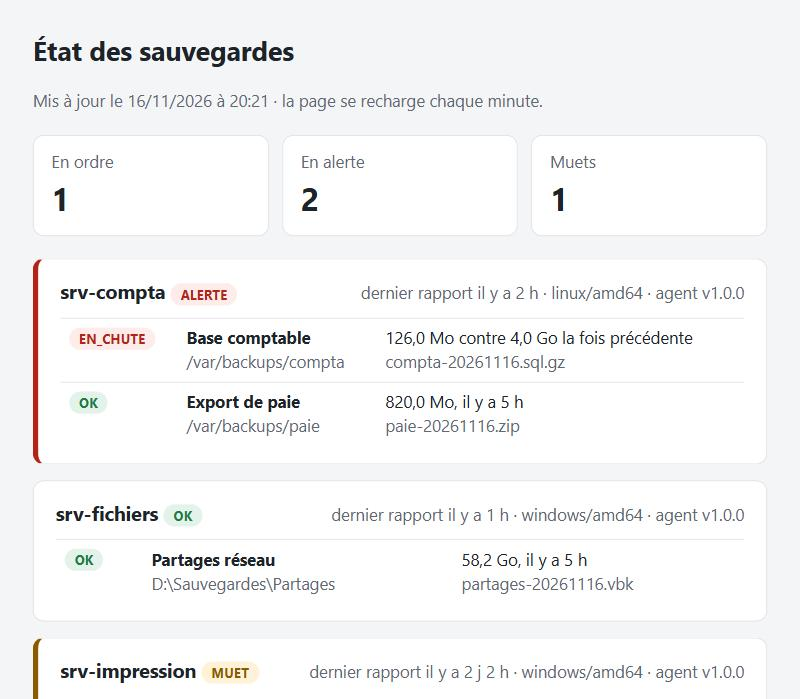

# Veille des sauvegardes

[](https://github.com/brakan1337/veille-sauvegardes/actions/workflows/ci.yml)

Chaque matin, un infogérant sait quelles sauvegardes de ses clients ont échoué cette nuit, et quels serveurs ne donnent plus de nouvelles.

**Go · Terraform · AWS · Bash · systemd · GitHub Actions**



*Aperçu produit par le vrai collecteur avec un parc d'exemple (`go run ./outils/apercu`).*

## Le brief

> Ce projet est un cas d'étude. L'infogérant et ses clients sont fictifs ; le brief sert à justifier les choix techniques.

Une société d'infogérance gère les serveurs de 40 PME, sous Windows et sous Linux. Les sauvegardes tournent la nuit, mais personne ne vérifie qu'elles ont vraiment marché. Une sauvegarde qui échoue en silence, on la découvre le jour où il faut restaurer.

Elle veut savoir chaque matin quelles sauvegardes manquent, sont trop vieilles, trop petites ou ont fondu par rapport à la veille. Elle veut aussi que les données d'un client ne côtoient jamais celles d'un autre.

**Trois langages, chacun à sa place :**

| Partie | Langage | Pourquoi celui-là |
|---|---|---|
| L'agent, posé sur chaque serveur | **Go** | Un seul fichier exécutable, sans rien installer chez le client : ni Python, ni Java, ni bibliothèque. Il se compile pour Windows et Linux depuis la même source et tient dans quelques Mo de mémoire. |
| Le collecteur, un par client | **Go** | Le même code partage le format des rapports avec l'agent. Aucune dépendance externe : seulement la bibliothèque standard, plus simple à auditer. |
| L'infrastructure de chaque client | **Terraform** | Chaque nouvelle PME reçoit son propre collecteur, identique aux autres, en ajoutant une ligne et en lançant `terraform apply`. |
| L'installation sur les serveurs Linux | **Bash** | Bash est déjà présent sur tous les serveurs. Le script crée l'utilisateur, installe l'agent et programme son passage quotidien avec systemd. |

## Ce que l'agent contrôle

Pour chaque sauvegarde déclarée (un dossier et un motif de fichier), il retient le fichier le plus récent et lui donne un statut :

| Statut | Signification |
|---|---|
| `OK` | récente, de taille normale |
| `ABSENTE` | aucun fichier ne correspond |
| `ANCIENNE` | la plus récente dépasse l'âge maximal (26 h par exemple) |
| `PETITE` | sous la taille minimale déclarée |
| `EN_CHUTE` | moins de la moitié de la précédente : une base qui passe de 4 Go à 126 Mo en une nuit, c'est rarement une bonne nouvelle |
| `ERREUR` | dossier illisible, ou partage réseau qui ne répond pas en 30 s |

Le collecteur ajoute un état propre au serveur : **MUET**. Un serveur dont aucun rapport n'est arrivé depuis 26 h est signalé. Un agent arrêté ne remonte aucune panne : c'est aussi grave qu'une sauvegarde ratée.

## Les choix qui comptent

- **Les contrôles tournent en parallèle, chacun avec son propre délai.** Un partage réseau figé peut bloquer la lecture d'un dossier indéfiniment ; il ne retarde jamais les autres contrôles ([`controle.go`](internal/controle/controle.go)).
- **Un collecteur injoignable ne fait rien perdre.** L'agent réessaie avec un délai qui double à chaque fois, puis garde le rapport dans une file locale et le renvoie au passage suivant. Un refus définitif, comme un jeton faux, n'est jamais retenté ([`envoi.go`](internal/envoi/envoi.go)).
- **Un rapport rattrapé en retard ne remplace pas un rapport plus récent.**
- **Pas de base de données à opérer.** Un collecteur sert un seul client, soit quelques dizaines de rapports par jour : un historique en fichier JSON Lines, écrit en ajout seul, suffit.
- **Les secrets ne sont jamais dans le script de démarrage de la machine.** Terraform génère le jeton des agents et le mot de passe du tableau de bord, et les range dans le coffre AWS (SSM Parameter Store). Au démarrage, la machine les lit grâce à son rôle, qui ne l'autorise à lire que les siens. Un test Terraform le vérifie.
- **Un client, une machine.** Aucune ressource n'est partagée entre deux clients.

## Architecture

```
Serveurs du client A                       AWS, compte de l'infogérant
┌──────────────────────┐                   ┌──────────────────────────────────┐
│ veille-agent (Go)    │── https ─────────►│ collecte.client-a.<domaine>      │
│ minuterie systemd    │   rapport JSON    │  Caddy (certificat automatique)  │
│ ou tâche Windows     │   jeton du client │  veille-collecteur (Go)          │
└──────────────────────┘                   │  secrets lus dans SSM            │
                                           └───────────────┬──────────────────┘
                                                           │ chaque matin
                                                           ▼
                                           Slack, Mattermost ou Teams (webhook)
```

```
cmd/agent/            le programme posé sur les serveurs
cmd/collecteur/       le programme qui reçoit les rapports
internal/controle/    les contrôles et la configuration de l'agent
internal/envoi/       l'envoi, les nouvelles tentatives, la file d'attente
internal/collecte/    le dépôt, la synthèse, le tableau de bord, le rapport du matin
deploiement/          installer-agent.sh
infra/modules/        le module Terraform d'un collecteur, et ses tests
infra/clients/        le parc : un collecteur par entrée de la liste des clients
```

## Utilisation

### Déployer les collecteurs (Terraform)

```bash
cd infra/clients && cp terraform.tfvars.exemple terraform.tfvars
```

```bash
terraform init && terraform apply
```

Ajouter un client, c'est ajouter une ligne dans `terraform.tfvars`, puis relancer `terraform apply`. Le jeton à donner aux agents s'obtient avec `terraform output -json jetons_agents`.

### Installer l'agent sur un serveur Linux (Bash)

```bash
sudo ./installer-agent.sh --collecteur https://collecte.boulangerie-dupuy.veille.infogerance.example \
  --jeton "$JETON" --url https://github.com/brakan1337/veille-sauvegardes/releases/download/v1.0.0/veille-agent-linux-amd64 \
  --config sauvegardes.json --lecture /var/backups
```

Le script peut se relancer sans risque. Il crée un utilisateur système sans connexion, ne donne à l'agent que le droit de lire les dossiers de sauvegarde, et programme un contrôle quotidien sous systemd.

Sous Windows, l'agent se programme avec le planificateur de tâches :

```bash
schtasks /Create /TN "Veille sauvegardes" /SC DAILY /ST 06:30 /RU SYSTEM /TR "C:\veille\veille-agent.exe -config C:\ProgramData\veille\agent.json"
```

### Configuration de l'agent

```json
{
  "collecteur": "https://collecte.boulangerie-dupuy.veille.infogerance.example",
  "jeton": "…",
  "sauvegardes": [
    {"nom": "Base comptable", "chemin": "/var/backups/compta", "motif": "compta-*.sql.gz", "age_max": "26h", "taille_min": "500Mo"},
    {"nom": "Partages", "chemin": "D:\\Sauvegardes", "motif": "*.vbk", "age_max": "2j", "taille_min": "10Go"}
  ]
}
```

`veille-agent -verifier` affiche le résultat des contrôles sans rien envoyer. Il sort avec le code 1 si une sauvegarde est en alerte, et 2 si la configuration est invalide.

## Tests

```bash
go test ./...
```

```bash
cd infra/modules/collecteur && terraform init -backend=false && terraform test
```

- **Go** : 22 tests, dont des tables de cas.
  - Chaque statut de sauvegarde, et le partage réseau figé.
  - Les unités de la configuration et les fautes de frappe.
  - Les nouvelles tentatives, la file d'attente et le rattrapage.
  - Le dépôt qui survit à un redémarrage, le serveur muet, l'authentification.
  - Un essai de bout en bout, de l'agent jusqu'au tableau de bord.
- **Terraform** : 8 tests sans compte AWS, avec des fournisseurs simulés.
  - Le nommage, IMDSv2, le disque chiffré.
  - SSH réservé à l'infogérant, aucun secret dans le script de démarrage.
  - Les saisies refusées.
- **Bash** : ShellCheck, et surtout une installation réelle dans la CI.

**Installation réelle dans la CI :** sur une machine Ubuntu de GitHub, un collecteur démarre, le script Bash installe l'agent pour de vrai sous systemd, et le service s'exécute. La CI vérifie ensuite que le collecteur a reçu le bon diagnostic : une base qui a fondu, des partages en ordre. Elle relance enfin le script pour prouver qu'il se rejoue sans casse.

Chaque version taguée publie les binaires pour Linux (amd64, arm64) et Windows, avec leurs sommes de contrôle.
